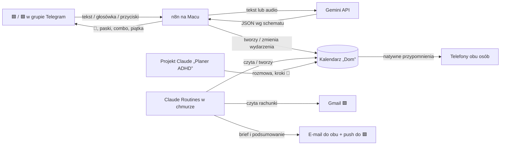

# Etap 0 „Dom”: organizer ADHD bez aplikacji

- **Data:** 2026-10-09
- **Status:** do przeglądu
- **Ścieżka:** architektoniczna (superpowers:brainstorming)
- **Następny krok po akceptacji:** plan implementacji (superpowers:writing-plans)

## 1. Cel

Dwie dorosłe osoby z ADHD (para, rodzice, mieszkają w UK) potrzebują wspólnego systemu na obowiązki, wizyty i rachunki, który:

- pozwala dodać sprawę w mniej niż 5 sekund, także głosem,
- przypomina niezawodnie na obu telefonach,
- daje natychmiastową, zmienną nagrodę za zrobienie rzeczy,
- nie wymaga budowania aplikacji, dopóki nie wiadomo, czego naprawdę brakuje.

Etap 0 wykorzystuje narzędzia, które już są opłacone: Kalendarz Google, Claude (Projekt, konektory, Routines), Gemini, n8n w Dockerze na MacBooku, Telegram, Wispr Flow.

### Kryteria sukcesu (po 4 tygodniach)

1. Każda z osób ma co najmniej 5 aktywnych dni w tygodniu (dzień z co najmniej jednym ✅) przez 4 kolejne tygodnie.
2. Zero rachunków 💸 bez ✅ po terminie.
3. Na koniec Etapu 0 istnieje lista braków, która uzasadnia (albo nie) Etap 1, czyli aplikację.

### Osoby

| Znacznik | Kto | Konto Google | Jak dodaje sprawy |
|---|---|---|---|
| 🟦 | Osoba A, właściciel `tjaisolution@gmail.com` | to konto | bot w Telegramie, Claude (Projekt „Planer ADHD”), Wispr Flow |
| 🟩 | Osoba B | własne konto Google | bot w Telegramie, Gemini lub aplikacja Kalendarz |
| 🟨 | razem | n/d | jak wyżej |

## 2. Zakres

**W Etapie 0:**

- wspólny kalendarz „Dom” jako jedyne źródło prawdy i silnik przypomnień,
- bot Telegram „Dom” w grupie z obiema osobami (n8n na Macu),
- rozumienie tekstu i głosówek przez Gemini API,
- grywalizacja: 🎰 Los, 🔥 Combo, 🙌 Piątka, cele osobiste i drużynowe,
- Routine poranna (plan dnia, rachunki z Gmaila, brief) i niedzielna (podsumowanie tygodnia),
- Projekt Claude „Planer ADHD” do rozmowy i rozbijania zadań na kroki,
- testy logiki, test parsowania, lista testów akceptacyjnych, CI.

**Poza Etapem 0** (świadomie, YAGNI):

- aplikacja mobilna, widok „Teraz”, ogród, skrzynka, boss (kandydaci do Etapu 1),
- serwer dla n8n (migracja tylko, jeśli usypianie Maca przeszkadza),
- open banking i płatności, dwukierunkowa synchronizacja z innymi kalendarzami,
- osobny moduł projektów (projekt to zadanie rozbite na kroki 🧩).

## 3. Decyzje

| Decyzja | Wybór | Powód |
|---|---|---|
| Dla kogo | tylko dla tej dwójki | prywatne subskrypcje mogą być rdzeniem; brak wymogów produktowych |
| Start | Etap 0 bez aplikacji, aplikacja później tylko dla braków | najszybszy efekt, budowa tylko tego, czego brakuje |
| Źródło prawdy | kalendarz „Dom” (tytuły i opisy wydarzeń) | przypomnienia działają bez bota i bez AI; brak osobnej bazy |
| Gdzie działa bot | n8n w Dockerze na MacBooku, odpytywanie Telegrama (long polling) | już działa; nic na Macu nie jest wystawione do internetu |
| Kanał bota | jedna grupa Telegram „Dom” (obie osoby + bot) | obie osoby widzą swoje losowania i piątki |
| Rozumienie wiadomości | Gemini API, płatny tier | obsługuje audio; w płatnym tierze treści nie są używane do ulepszania usług |
| Planowanie i rachunki | Claude: konektory Kalendarz i Gmail, Routines w chmurze | działa bez włączonego Maca, w ramach subskrypcji |
| Grywalizacja | 🎰 Los + 🔥 Combo + 🙌 Piątka, punkty per osoba | wybór po prototypie „Laboratorium nagród” |
| Pokazywanie postępu | % własnego celu, nie surowe punkty | każda osoba konkuruje ze swoim poprzednim tygodniem |

Rozważone i odłożone: aplikacja Expo + Supabase (kandydat na Etap 1), PWA, Flutter + Firebase, własny backend Node. Szczegóły w rozmowie, która doprowadziła do tego dokumentu.

## 4. Architektura

Podział ról: **bot to ręce** (szybko, deterministycznie), **Claude to głowa** (planowanie według harmonogramu), **kalendarz „Dom” to pamięć i przypomnienia**.



| Element | Odpowiada za | Zależy od |
|---|---|---|
| Kalendarz „Dom” | terminy, przypomnienia, stan ✅, punkty w opisach | Google Calendar; obie osoby mają prawo edycji |
| Kalendarz osoby 🟩 | widoczność zajętości (tylko odczyt dla 🟦) | udostępnienie przez 🟩 |
| Bot (n8n) | dodawanie, przyciski, wykrywanie kolizji, 🎰, combo, piątka, cele | Telegram Bot API, Gemini API, Google Calendar API |
| Gemini | zamiana wiadomości na JSON według `schemas/zadanie.schema.json` | klucz API, limit dzienny |
| Routine poranna | plan dnia, porządkowanie 📥, rachunki z Gmaila, brief | konektory Kalendarz i Gmail |
| Routine niedzielna | podsumowanie tygodnia, wyróżnienia, zaległości | konektor Kalendarz, Gmail (wysyłka) |
| Projekt „Planer ADHD” | rozmowa, rozbijanie zadań na kroki 🧩, wstawianie bloków czasu | konektor Kalendarz |

Strefa czasowa wszędzie: `Europe/London`.

n8n odpytuje Telegram (`getUpdates`) co najwyżej co 5 sekund, więc przy włączonym Macu bot odpowiada w ciągu kilku sekund. Udane wykonania tego workflow nie są zapisywane w historii n8n, żeby jej nie zapychać.

## 5. Konwencje w kalendarzu „Dom”

**Tytuł:** `[✅ ]<osoba> [<typ> ]<treść>`

- osoba: 🟦, 🟩 albo 🟨 (razem), zawsze na początku (po ewentualnym ✅),
- typ: 💸 rachunek, 🧩 krok większej rzeczy, 📥 nieposortowane; zwykłe zadanie i wizyta bez emoji,
- zrobione: `✅ ` na samym początku tytułu.

Przykłady: `🟦 Odkurzyć salon`, `✅ 🟨 💸 Council tax £182 – pobranie 1.11`, `🟩 🧩 Krok 2/5: Zebrać P60`.

**Opis:** linie `klucz: wartość` dla maszyn, pod spodem dowolny tekst dla ludzi.

| Klucz | Przykład | Kto pisze |
|---|---|---|
| `utworzone_przez` | `bot`, `claude`, `ręcznie` | bot, Routines |
| `źródło` | `telegram:<message_id>`, `gmail:<message_id>` | bot, Routines |
| `kwota` | `£182.00` | Routine poranna |
| `termin` | `2026-11-01` | Routine poranna |
| `zrobione` | `2026-10-12T18:07 🟦` | bot |
| `pkt` | `3` | bot |

**Każda sprawa ma datę.** Gdy brakuje terminu, bot pyta przyciskami [Dziś] [Jutro] [Weekend] [Przyszły tydzień]. Gdy brakuje godziny: [Rano 9:00] [Po południu 15:00] [Wieczór 19:00] [Cały dzień].

**Wydarzenia dodane ręcznie** bez emoji osoby: osobę ustala się z pola `creator.email` wydarzenia (mapowanie e-mail → 🟦/🟩 w konfiguracji).

## 6. Przepływy

### 6.1 Dodanie sprawy przez bota

1. Wiadomość w grupie od dozwolonego użytkownika: tekst albo głosówka.
2. n8n wysyła treść (lub audio) do Gemini razem z dzisiejszą datą i strefą czasową.
3. Odpowiedź jest walidowana schematem (sekcja 8). Błąd: jedna ponowna próba, potem pytanie do człowieka.
4. Kontrole deterministyczne w n8n: data od dziś do +365 dni; jeśli tekst zawiera nazwę dnia tygodnia, wyliczona data musi wypadać w ten dzień; przy niezgodności bot pyta.
5. Sprawdzenie kolizji (6.4).
6. Utworzenie wydarzenia w „Dom” (domyślnie 30 min, przypomnienie 10 min wcześniej).
7. Potwierdzenie z jawną datą, np. „🟦 Dentysta · pt 17.10, 18:00” i przyciskami [✅ Zrobione] [⏰ +15 min] [Jutro] [↩️ Cofnij].

Brak osoby w wiadomości oznacza osobę wysyłającą.

### 6.2 Przyciski

| Przycisk | Działanie |
|---|---|
| ✅ Zrobione | dopisuje `✅ ` do tytułu, `zrobione` i `pkt` do opisu, potem 🎰, combo, piątka i paski (sekcja 7) |
| ⏰ +15 min | przesuwa wydarzenie o 15 minut; przypomnienie zadziała ponownie |
| Jutro | przenosi na jutro, ta sama godzina |
| ↩️ Cofnij | usuwa wydarzenie, tylko jeśli `utworzone_przez: bot` i utworzone w ostatnich 24 h |

`callback_data` zawiera akcję i krótki klucz; mapowanie klucz → ID wydarzenia jest w danych statycznych workflow (ważne 14 dni).

Komenda `/zalegle` przenosi na jutro wszystkie niezrobione, przeterminowane sprawy osoby wysyłającej i sprawy 🟨.

### 6.3 Osoba 🟩 przez Gemini

Gemini dodaje do własnego kalendarza osoby 🟩, nie do „Dom”. Sprawy wspólne idą przez bota. Kalendarz 🟩 jest udostępniony 🟦 do podglądu, więc kolizje i brief go uwzględniają.

### 6.4 Kolizje

n8n sprawdza zajętość w „Dom”, w głównym kalendarzu 🟦 i w kalendarzu 🟩 w czasie nowej sprawy. Przy nakładaniu się: „⚠️ koliduje z X” i przyciski [Wstaw o HH:MM] (najbliższe wolne 30 min w ciągu 3 h) [Zostaw]. Bez udziału AI.

### 6.5 Rachunki (Routine poranna)

1. Wyszukanie w Gmailu 🟦 wiadomości z ostatnich 2 dni pasujących do: invoice, bill, statement, direct debit, payment due, faktura, rachunek.
2. Z każdej wyciągnięcie: dostawca, kwota, data pobrania lub termin.
3. Jeśli w „Dom” nie ma wydarzenia ze `źródło: gmail:<id>`: utworzenie całodniowego `🟨 💸 <dostawca> £<kwota> – pobranie <data>` na 3 dni przed terminem (a jeśli do terminu zostały mniej niż 3 dni, na dziś), z kluczami `kwota`, `termin`, `źródło`.
4. Rachunki przychodzące do 🟩 trafiają do 🟦 filtrem przekierowania w Gmailu 🟩.

W UK większość rachunków to Direct Debit, więc ✅ przy 💸 oznacza „sprawdzone saldo / zapłacone”.

### 6.6 Brief poranny (07:30)

Routine czyta dzisiejsze i jutrzejsze wydarzenia z „Dom” i zajętość 🟩, porządkuje 📥 (nadaje datę, osobę i typ, zmieniając istniejące wydarzenie) i wysyła e-mail do obu osób:

- dziś: najważniejsze 3 rzeczy na osobę i wspólne,
- 💸 w ciągu 7 dni,
- zaległości z propozycją: „przenieś” albo „odpuść”.

🟦 dostaje też powiadomienie push z Routine.

### 6.7 Podsumowanie tygodnia (niedziela 19:00)

Routine sumuje `pkt` per osoba z ostatnich 7 dni, liczy aktywne dni, wyróżnienia (rekord osobisty, najlepszy dzień, najdłuższe combo) i wynik drużyny. Nigdy nie wskazuje, kto „wygrał”. Wysyła e-mail do obu i push do 🟦.

## 7. Grywalizacja

### 7.1 Punkty za ✅

Każde ✅ to 1 punkt bazowy plus bonusy. Punkt bazowy dostaje osoba, która kliknęła ✅ (rozpoznana po `from.id`); przy sprawach 🟨 punkt bazowy dostają obie osoby. Bonusy (🎰, 🔥) zawsze dostaje tylko osoba, która kliknęła. ✅ dodane ręcznie w kalendarzu: punkt bazowy dla osoby z tytułu (🟨: obu), bez bonusów.

### 7.2 🎰 Los

Po każdym ✅ bot wysyła `sendDice` z emoji 🎰. Wynik `dice.value` (1–64) koduje trzy bębny: `v − 1 = b1 + 4·b2 + 16·b3`. Odpowiedź z wynikiem pojawia się po zakończeniu animacji (ok. 2 s).

| Wynik | Wartości | Szansa | Bonus |
|---|---|---|---|
| 777 | 64 | 1,6% | +9 (razem +10) |
| inna trójka | 1, 22, 43 | 4,7% | +4 (razem +5) |
| para | 36 wartości | 56,3% | +1 (razem +2) |
| brak pary | 24 wartości | 37,5% | 0 (razem +1) |

Los nigdy nie odejmuje punktów.

### 7.3 🔥 Combo

✅ w ciągu 20 minut od własnego poprzedniego ✅ podnosi mnożnik: x2, x3, … do x5. Bonus = mnożnik − 1. Przerwa dłuższa niż 20 minut zeruje combo. Czas poprzedniego ✅ jest w danych statycznych workflow (z odtworzeniem z opisów `zrobione` po restarcie).

### 7.4 🙌 Piątka

Gdy ✅ jednej osoby pada najpóźniej 60 minut po ostatnim ✅ drugiej osoby: +2 dla każdej i animowana wiadomość w grupie. Następna piątka możliwa po 60 minutach. Piątka jest wyłącznie pozytywna; bot nigdy nie komentuje, że ktoś czegoś nie zrobił.

### 7.5 Cele i paski

- Cel tygodnia osoby = 90% średniej jej punktów z ostatnich 2 pełnych tygodni, zaokrąglone w górę; minimum 5. Pierwsze 2 tygodnie: 5.
- Cel drużyny = suma celów osobistych.
- Tydzień: poniedziałek 00:00 – niedziela 23:59, `Europe/London`.
- n8n liczy cele sam z punktów w kalendarzu i trzyma je w danych statycznych na bieżący tydzień.
- Po każdym ✅ bot pokazuje: `🟦 ▓▓▓▓░ 80%  🟩 ▓▓▓░░ 55%  🎯 drużyna ▓▓▓▓░ 70%`.
- Osiągnięcie celu osobistego: losowa nagroda z listy tej osoby. Celu drużyny: losowa nagroda wspólna. Listy w `config/nagrody.json`.
- Brak kar, brak czerwonych liczników. Zaległości mają tylko opcje „przenieś” albo „odpuść”.

## 8. Kontrakt parsowania (Gemini)

Odpowiedź Gemini musi spełniać `schemas/zadanie.schema.json`:

| Pole | Typ | Uwagi |
|---|---|---|
| `tytul` | string, 1–80 znaków | bez emoji osoby i typu |
| `osoba` | `"🟦"`, `"🟩"`, `"🟨"` albo `null` | `null` → osoba wysyłająca |
| `typ` | `"zadanie"`, `"wizyta"`, `"rachunek"` | |
| `data` | `YYYY-MM-DD` albo `null` | `null` → pytanie o dzień |
| `godzina` | `HH:MM` albo `null` | `null` → pytanie o porę |
| `czas_min` | liczba całkowita 5–480 albo `null` | `null` → 30 |
| `kwota` | liczba albo `null` | tylko dla rachunków |
| `pewnosc` | liczba 0–1 | poniżej 0,7 → pytanie zamiast zapisu |

Gemini wypełnia wyłącznie te pola. O akcjach (tworzenie, przesuwanie, usuwanie) decyduje n8n, nie model.

## 9. Obsługa błędów

| Sytuacja | Zachowanie |
|---|---|
| Mac uśpiony | wiadomości czekają w Telegramie (do 24 h); jeśli termin minął, bot pyta, co zrobić |
| Zły JSON z Gemini | jedna ponowna próba, potem pytanie z przyciskami; nigdy cichy zapis |
| Niepewna lub niespójna data | pytanie z przyciskami; potwierdzenie zawsze pokazuje pełną datę |
| Limit dzienny Gemini lub błąd klucza | zapis `<osoba> 📥 <oryginalny tekst>` na dziś; Routine poranna porządkuje |
| Kolizja | ostrzeżenie i propozycja wolnego terminu |
| Wygasły token Google w n8n | workflow błędów wysyła wiadomość do 🟦; aplikacja OAuth w stanie „In production” |
| Błąd Routine | przypomnienia działają dalej; Claude pokazuje błąd; następny brief nadrabia |
| Duplikat rachunku | wykrywany po `źródło: gmail:<id>` |
| Restart n8n | offset Telegrama i dane statyczne odtwarzane; brak podwójnego przetworzenia aktualizacji |

## 10. Bezpieczeństwo i prywatność

- Bot reaguje tylko w jednej grupie (`TELEGRAM_CHAT_ID`) i tylko na dwa ID użytkowników.
- Tryb prywatności bota wyłączony w BotFather, żeby widział zwykłe wiadomości w grupie.
- Sekrety tylko w `n8n/.env` (poza repo); w repo `n8n/.env.example`.
- n8n ma dostęp do Kalendarza Google w zakresie odczytu zajętości i edycji wydarzeń; aplikacja OAuth do własnego użytku, stan „In production”.
- Routines: wolno im tworzyć i zmieniać wydarzenia w „Dom” oraz wysyłać e-mail wyłącznie na dwa stałe adresy; nie usuwają niczego.
- Treść e-maili jest niezaufana: Routine wyciąga z niej tylko dostawcę, kwotę i datę; polecenia w treści są ignorowane.
- Gemini: tylko płatny tier; do modelu trafiają wyłącznie wiadomości z grupy, bez numerów kont.
- Limit `GEMINI_DAILY_LIMIT` wywołań dziennie liczony w n8n oraz alert budżetowy w Google Cloud.

## 11. Testy

1. **Jednostkowe** (`node:test`, bez zależności), dla funkcji w `src/`:
   - wszystkie 64 wartości 🎰 i ich bonusy,
   - granice combo: 19, 20, 21 minut; maksimum x5,
   - piątka: okno 60 minut i przerwa 60 minut,
   - formuła celu tygodnia i minimum 5,
   - budowanie i czytanie tytułów oraz opisów,
   - wykrywanie duplikatów rachunków,
   - kontrola dnia tygodnia i zakresu dat.
2. **Parsowanie:** zestaw około 30 fraz (polski, angielski, mieszane) z oczekiwanym wynikiem w `tests/parse-golden.json`, uruchamiany ręcznie `npm run eval:parse` z kluczem Gemini. Próg: co najmniej 90% pełnej zgodności i **zero błędnych dat zapisanych bez pytania**.
3. **Schemat:** przykładowe poprawne i niepoprawne JSON-y sprawdzane względem `schemas/zadanie.schema.json`.
4. **Akceptacyjne** na kalendarzu „Dom-TEST” (lista w `docs/testy-akceptacyjne.md`): dodanie tekstem i głosówką, ✅, ⏰ +15 min, Jutro, ↩️ Cofnij, `/zalegle`, kolizja, Mac uśpiony (zatrzymany kontener, wiadomość, start), zły klucz Gemini (zapis 📥), 777 i piątka (wartości wstrzyknięte w trybie testowym).
5. **Routines:** pierwszy tydzień w trybie testowym, czyli zapis do „Dom-TEST” i e-mail tylko do 🟦; potem przełączenie na „Dom”.
6. **CI (GitHub Actions):** testy jednostkowe, walidacja schematu, kontrola, że wyeksportowane workflow nie zawierają tokenów ani kluczy.

## 12. Struktura repo

```
docs/superpowers/specs/      specyfikacje (ten plik)
docs/superpowers/plans/      plany implementacji
docs/testy-akceptacyjne.md   lista testów ręcznych
n8n/docker-compose.yml       konfiguracja n8n bez sekretów
n8n/.env.example             nazwy zmiennych
n8n/workflows/*.json         wyeksportowane workflow: dodawanie, przyciski, błędy
src/                         logika jako czyste funkcje JS
scripts/sync-code-nodes.mjs  wkleja funkcje z src/ do węzłów Code w workflow
scripts/setup.sh             uruchamia n8n i importuje workflow
schemas/zadanie.schema.json  kontrakt odpowiedzi Gemini
prompts/planer-adhd.md       instrukcje Projektu Claude
prompts/routine-poranna.md   prompt Routine porannej
prompts/routine-niedzielna.md prompt Routine niedzielnej
prompts/gemini-parse.md      prompt parsowania
config/nagrody.json          listy nagród 🟦, 🟩 i wspólnych
config/osoby.json            mapowanie ID Telegrama i e-maili na 🟦 / 🟩
tests/                       testy jednostkowe i zestaw do parsowania
.github/workflows/ci.yml     CI
```

## 13. Konfiguracja

`n8n/.env.example`:

| Zmienna | Znaczenie |
|---|---|
| `TELEGRAM_BOT_TOKEN` | token bota z BotFather |
| `TELEGRAM_CHAT_ID` | ID grupy „Dom” |
| `GEMINI_API_KEY` | klucz Gemini API (płatny tier) |
| `GEMINI_MODEL` | model z obsługą structured output i audio |
| `GEMINI_DAILY_LIMIT` | maksymalna liczba wywołań dziennie, domyślnie 200 |
| `DOM_CALENDAR_ID` | ID kalendarza „Dom” |
| `DOM_TEST_CALENDAR_ID` | ID kalendarza „Dom-TEST” |
| `PARTNER_CALENDAR_ID` | ID kalendarza 🟩 (podgląd) |
| `GENERIC_TIMEZONE`, `TZ` | `Europe/London` |

ID użytkowników Telegrama i adresy e-mail są w `config/osoby.json` (plik lokalny; w repo wersja przykładowa).

Prompty Routine w `prompts/` są szablonami ze zmiennymi (`{{EMAIL_NIEBIESKI}}`, `{{EMAIL_ZIELONY}}`, `{{DOM_CALENDAR_ID}}`, `{{PARTNER_CALENDAR_ID}}`). Prawdziwe wartości wpisuje się przy tworzeniu Routine, więc dane osobowe nie trafiają do repo.

## 14. Ryzyka

| Ryzyko | Ograniczenie |
|---|---|
| Mac śpi, bot odpowiada z opóźnieniem | przypomnienia i Routines nie zależą od Maca; migracja na serwer to ten sam `docker compose` i eksport workflow |
| Gemini nie przyjmie głosówek Telegrama (OGG/Opus) | test akceptacyjny w pierwszym kroku planu; zapasowo konwersja `ffmpeg` w kontenerze, a do tego czasu dyktowanie tekstu przez Wispr Flow |
| Limity planu Claude Pro dla Routines | 2 uruchomienia dziennie; w razie problemów rzadsze podsumowania |
| Znudzenie nagrodami | ocena w niedzielnych podsumowaniach; nowe warianty z prototypu w Etapie 1 |
| Ostrzeżenie Google o niezweryfikowanej aplikacji OAuth | jednorazowa akceptacja przy konfiguracji |
| Ręczne zmiany tytułów łamią konwencje | parser tolerancyjny; osoba z `creator.email`; brak typu oznacza zwykłe zadanie |

## 15. Wyjście z Etapu 0

Po 3–4 tygodniach niedzielne podsumowania dają listę braków. Decyzja o Etapie 1 (aplikacja Expo + Supabase dla braków, np. widok „Teraz” i bogatsze nagrody) zapada na podstawie tej listy i kryteriów sukcesu z sekcji 1. Aplikacja czyta ten sam kalendarz „Dom”, więc nic nie przepada.
